<h1 align="center">Hi, I'm Maxmudbek Jumaniyazov 👋</h1>

  <b>Full-stack developer from Khiva, Uzbekistan</b> 
  I build multilingual websites for tourism and hospitality, business management systems, and Telegram bots.

  
  
  
  
  
  

---

### 🛠 Tech stack

   
  

### 🚀 Featured projects

| Project | What it is | Stack |
|---|---|---|
| **[Khiva Guide](https://khivaguide.uz)** | Travel guide for Khiva & Khorezm in 5 languages | Astro, Tailwind CSS, Node.js |
| **Islambek Khiva** | Hotel and tour agency sites in one monorepo, with a CMS for staff | Next.js 15, Payload CMS 3, Turborepo |
| **[islambek-khiva.uz](https://islambek-khiva.uz)** | Fast, SEO-friendly trilingual hotel website | Python, Jinja2, Nginx, GitHub Actions |
| **Yukla Bot** | Telegram bot that downloads media from 15+ platforms, with a job queue and caching | TypeScript, grammY, BullMQ, Redis, PostgreSQL |
| **LifeOS** | Personal productivity app: calendar, goals, routines, finance, notes | Next.js 15, Prisma, PostgreSQL |
| **Savdo Boshqaruv** | Retail store management SaaS with admin panel and Telegram integration | React, Express, PostgreSQL |
| **University KPI System** | KPI tracking and management for university staff | React, TypeScript, shadcn/ui, TanStack Query |
| **[Modern CMS](https://github.com/Mr-uzbek/Modern_CMS_Python)** | Content management system with JWT auth, comments and media | Python, FastAPI, Docker |

Most of these are client projects, so their source code is private.

<b>🇺🇿 O'zbekcha</b>

 

Salom! Men Maxmudbek Jumaniyazov, Xivadan full-stack dasturchiman.

Turizm va mehmonxonalar uchun ko'p tilli saytlar, biznesni boshqarish tizimlari va Telegram botlar yarataman. Asosan TypeScript, Next.js, Node.js va Python bilan ishlayman.

**Asosiy loyihalar:**
- **[Khiva Guide](https://khivaguide.uz)**: Xiva va Xorazm bo'yicha 5 tilli sayohat qo'llanmasi
- **Islambek Khiva**: mehmonxona va turagentlik saytlari, xodimlar uchun CMS bilan
- **Yukla Bot**: 15 dan ortiq platformadan video va audio yuklab beradigan Telegram bot
- **LifeOS**: shaxsiy samaradorlik ilovasi
- **Savdo Boshqaruv**: do'konlar uchun savdo va ombor boshqaruv tizimi
- **Universitet KPI tizimi**: universitet xodimlarining KPI ko'rsatkichlarini boshqarish

Hamkorlik uchun [Telegram](https://t.me/Mrclaudecode) yoki [email](mailto:miraclecampchat@gmail.com) orqali yozing.

---

### 📊 GitHub stats

  
  

  

